<a id="russian"></a>

<div align="center">
  <a href="https://check-risk.ru/">
    
  </a>

  <h1>Check Risk WAF</h1>

  <p><strong>Российское комплексное решение для защиты веб-приложений и инфраструктуры</strong></p>
  <p>WAF, Anti-Bot, Anti-DDoS и AI-помощник. В облаке Check Risk или на вашем сервере.</p>

  <p>
    <a href="#saas"></a>
    <a href="#on-premise"></a>
    <a href="#protection">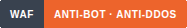</a>
    <a href="#ai">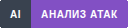</a>
  </p>

  <p>
    <a href="https://check-risk.ru/"></a><br>
    <strong>Включён в реестр российского ПО Минцифры России.</strong><br>
    <a href="https://reestr.digital.gov.ru/reestr/7075261/">Реестровая запись №32239 от 17.02.2026</a>
  </p>

  <p>
    <a href="https://check-risk.ru/"><strong>Сайт</strong></a> ·
    <a href="https://check-risk.ru/docs"><strong>Документация</strong></a> ·
    <a href="#protection">Защита</a> ·
    <a href="#features">Возможности</a> ·
    <a href="#interface">Интерфейс</a> ·
    <a href="#on-premise">Установка</a> ·
    <a href="#saas">SaaS</a>
  </p>

  <p><a href="#russian"><strong>Русский</strong></a> · <a href="#english">English</a></p>
</div>

<a id="protection"></a>

## Три основных модуля защиты

**Check Risk WAF** обеспечивает защищиту сайтов, веб приложений и API. Решение проверяет входящий HTTP/HTTPS-трафик в режиме Reverse proxy (обратного прокси) и передаёт отфильтрованные запросы защищаемым приложениям. Подключение продукта не требует изменения кода сайта.

| Модуль | Защита |
| --- | --- |
| **WAF** | OWASP top 10, SQL-инъекции, XSS, выполнение команд, включение файлов, обход путей, протокольные аномалии и другие атаки на веб-приложения |
| **Anti-Bot** | Автоматизированные запросы, сканирование, парсинг и спам. Проверка браузера, кнопка, капча-пазл и интеллектуальный выбор проверки |
| **Anti-DDoS** | Аномальная нагрузка, массовые соединения и вредоносные источники. Автоблокировка, IP-группы и анализ эпизодов атак |

Защиту приложений дополняет встроенный модуль  **Rate Limit**, обновляемые базы фидов, которые включаю в себя перечни опасных IP и User-Agent, проверка поисковых роботов и пользовательские правила безопасности. Условия фильтрации можно задавать по приложению, URL, методу, заголовкам, телу запроса, IP и географии клиента. Такой подход к защите обеспечивает комплексную безопасность веб приложений.

Check Risk включает в себя конфигурацию выбора уровня защиты как для всех приложений, так и для  отдельного сайта. Режим мониторинга позволяет изучить WAF-срабатывания перед включением блокировки. Для SaaS сетевая фильтрация работает непосредственно в инфраструктуре Check Risk. При установке on-premise защита веб приложений обеспечивается локально, вплоть до закрытых контуров безопасности.

<a id="features"></a>

## Возможности Check Risk WAF

**✓** — функция доступна · **✗** — функция отсутствует в этом варианте поставки.

| Возможность | Описание | On-premise | SaaS |
| --- | --- | :---: | :---: |
| **Подключение веб-приложений под защиту WAF** | Создание и управление защищаемыми доменами и приложениями с привязкой портов, серверов назначения, SSL-сертификатов и индивидуальных настроек защиты. | **✓** | **✓** |
| **Подтверждение владения доменом** | Проверка владения доменом перед подключением к облачной защите. | **✗** | **✓** |
| **Уровни защиты** | Настройка интенсивности фильтрации от стандартного до максимального уровня глобально или отдельно для конкретного приложения. | **✓** | **✓** |
| **Проксирование и маршрутизация трафика** | Прием HTTP/HTTPS-трафика, проверка запросов и передача очищенного трафика на серверы приложения. | **✓** | **✓** |
| **Защита от типовых веб-атак** | Обнаружение и блокировка XSS, SQL-инъекций, атак включения файлов, удаленного выполнения кода, сканеров и протокольных аномалий. | **✓** | **✓** |
| **Пользовательские правила WAF** | Создание разрешающих, блокирующих и исключающих правил с условиями по IP, географии, приложению, URL, host, заголовкам, параметрам, телу запроса и HTTP-методу. | **✓** | **✓** |
| **Исключения и точная настройка срабатываний** | Настройка исключений для отдельных правил и сценариев, чтобы снижать ложные срабатывания без отключения защиты целиком. | **✓** | **✓** |
| **IP-группы и списки адресов** | Создание групп IP-адресов и сетей для дальнейшего использования в правилах разрешения, блокировки и исключений. | **✓** | **✓** |
| **Географическая фильтрация** | Использование страны клиента в правилах защиты и аналитике трафика. | **✓** | **✓** |
| **Anti-bot защита** | Проверка подозрительного автоматизированного трафика и отделение ботов от легитимных пользователей. | **✓** | **✓** |
| **Настройка доверенных ботов** | Управление обработкой проверенных ботов: разрешать всех, запрещать всех или разрешать только выбранный список. | **✓** | **✓** |
| **Условное применение anti-bot** | Включение anti-bot проверок только для заданных условий, например определенных URL, методов, параметров, заголовков или групп посетителей. | **✓** | **✓** |
| **Ограничение частоты запросов (Rate Limit)** | Правила ограничения запросов по приложению, клиентскому IP и условиям запроса. | **✓** | **✓** |
| **Настройка источника клиентского IP** | Выбор доверенного источника реального IP клиента и действия при недоверенной цепочке проксирования. | **✓** | **✓** |
| **TLS/SSL-настройки** | Управление SSL-протоколами, наборами шифров, HTTP/1, HTTP/2, принудительным HTTPS и HSTS. | **✓** | **✓** |
| **Загрузка пользовательских SSL-сертификатов** | Добавление собственных сертификатов и ключей с проверкой корректности, соответствия ключа сертификату и срока действия. | **✓** | **✓** |
| **Выпуск сертификатов Let's Encrypt** | Выпуск сертификатов для публичных доменов и автопродление. Wildcard через управляемый DNS — в SaaS. | **✓** | **✓** |
| **Управляемый DNS** | Создание и ведение DNS-зон для доменов, подключаемых к WAF, с проверкой делегирования и статуса зоны. | **✗** | **✓** |
| **Управление DNS-записями** | Создание, изменение и отключение основных типов DNS-записей, включая A, AAAA, CNAME, MX, NS, TXT, CAA, SRV и другие. | **✗** | **✓** |
| **Импорт и экспорт DNS-зон** | Импорт zone file, сравнение изменений, экспорт целевого состояния зоны и отслеживание статусов применения. | **✗** | **✓** |
| **Автосинхронизация WAF DNS-записей** | Автоматическое создание и обновление служебных DNS-записей, направляющих трафик домена через WAF. | **✗** | **✓** |
| **Публичные тестовые домены** | Предоставление тестового адреса для проверки прохождения трафика через WAF до переключения основного домена. | **✗** | **✓** |
| **Настройка HTTP-заголовков** | Добавление или удаление заголовков запросов и ответов для проксирования, совместимости и усиления безопасности. | **✓** | **✓** |
| **Поддержка прокси-заголовков** | Настройка передачи исходного протокола, host и цепочки клиентских IP при проксировании запроса. | **✓** | **✓** |
| **Сжатие ответов** | Включение сжатия ответов для повышения эффективности передачи данных. | **✓** | **✓** |
| **Поддержка SSE** | Поддержка потоковой передачи событий для приложений, которым нужны постоянные HTTP-соединения. | **✓** | **✓** |
| **Кастомные страницы ошибок** | Настройка текста и HTML-страниц для блокировок, превышения лимитов, ошибок шлюза, таймаута и anti-bot проверки. | **✓** | **✓** |
| **Журналирование событий** | Сбор журналов обычных запросов и событий безопасности с данными о домене, клиенте, запросе, статусе, сработавшем правиле и действии системы. | **✓** | **✓** |
| **Аналитика трафика и атак** | Агрегация показателей по запросам, посетителям, блокировкам, ошибкам, странам, страницам, источникам переходов, user-agent и IP-адресам. | **✓** | **✓** |
| **Дашборд WAF** | Отображение ключевых метрик защиты: запросов, посетителей, блокировок, ошибок, anti-bot проверок, нагрузки, топ IP, стран, страниц и статусов. | **✓** | **✓** |
| **Анализ атак и эпизодов** | Группировка связанных событий атак с указанием длительности, числа событий, уникальных IP и наличия блокировок. | **✓** | **✓** |
| **Просмотр деталей HTTP-запроса** | Переход от события атаки к деталям запроса, сообщениям правил, статусу ответа и действию системы. | **✓** | **✓** |
| **Создание правил из событий атак** | Формирование нового правила или исключения на основе конкретного события в журнале атак. | **✓** | **✓** |
| **AI-анализ атак** | Анализ выбранного события атаки, определение характера события и подготовка рекомендации или правила при ложном срабатывании. | **✓** | **✓** |
| **Интеграция с SIEM** | Передача событий запросов и безопасности во внешние системы мониторинга и корреляции событий. | **✓** | **✓** |
| **Глобальные и локальные настройки** | Настройка параметров защиты глобально для пользователя или индивидуально для отдельного приложения. | **✓** | **✓** |
| **Права субпользователей** | Разграничение доступа к сайтам, статистике, атакам, правилам, IP-группам и настройкам; к DNS — в SaaS. | **✓** | **✓** |
| **Тарифные лимиты и дополнительные QPS** | Учет тарифного плана, базового лимита производительности и дополнительных оплачиваемых QPS. | **✗** | **✓** |
| **Клиентские WAF-кластеры** | Выделенные облачные кластеры для клиентов с отдельными параметрами эксплуатации и хранения данных. | **✗** | **✓** |

<a id="interface"></a>

## Панель управления: главные функции

### Атаки: подробная аналитика

В системе доступна подробная аналитика инцидента. Для доступа к ней открывайте инциденты, переходите к подробностям и наводите курсор на подчёркнутый фрагмент: рядом появится сработавшее правило. В одном журнале видны приложение, IP, география, исходный запрос и действие защиты. Фильтры помогают быстро найти нужное событие, а представление cURL — воспроизвести запрос.

[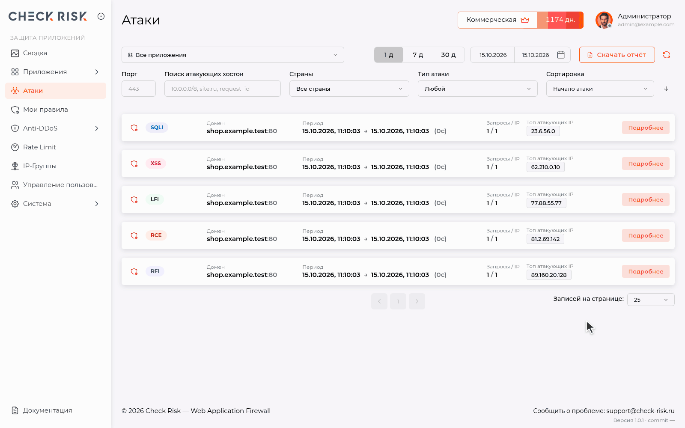](assets/attacks.gif)

<a id="ai"></a>

### AI-помощник: помощник в аналитики инцидентов

В системе доступен AI ассистент для аналитики угрозы. Для доступа к нему откройте подробное описание инцидента и нажмите **«Спросить у AI»**. Помощник разберёт запрос и объяснит причину срабатывания. В примере SQL-фрагмент находится в ответе на учебное задание: AI предлагает точечное исключение.

[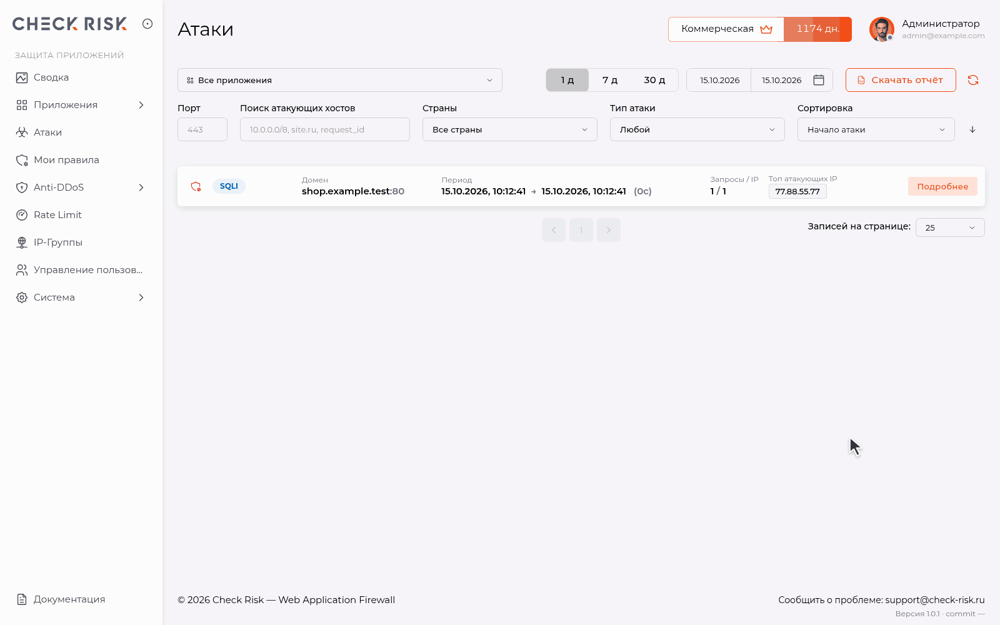](assets/ai-analysis.gif)

<a id="rules"></a>

### Правила: настройка правил блокировок и исключений

В система доступна гибкая система созданий правил блокировок и исключений. Для добавления привил создайте группу, выберите приложение и добавляйте правила внутри неё. Условия группы применяются ко всем вложенным правилам — сайт не нужно выбирать заново. Визуальный редактор поддерживает логические цепочки И/ИЛИ, JSONPath, XPath, заголовки, cookies и параметры запросов.

[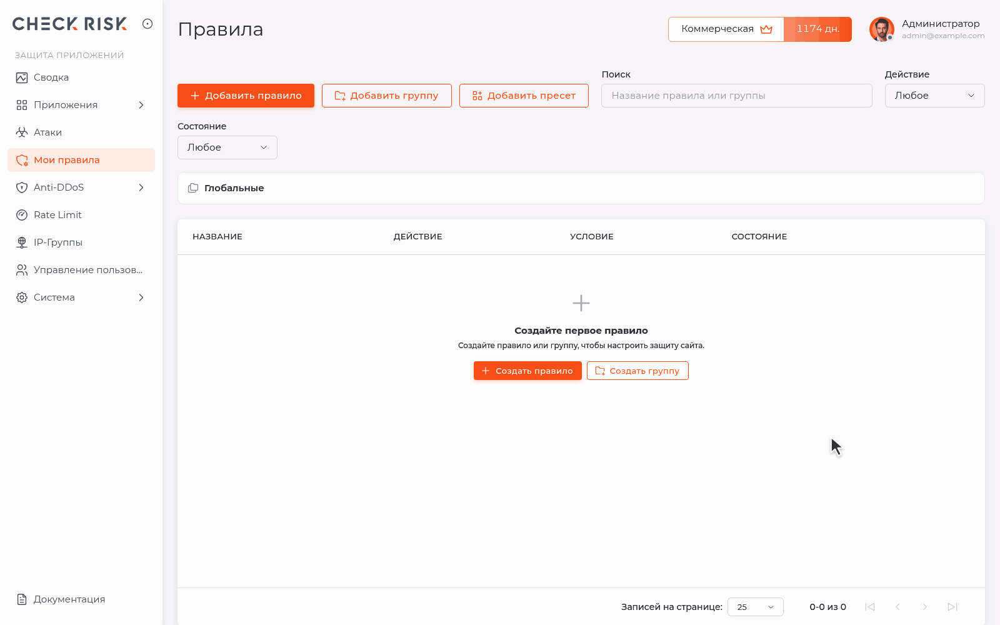](assets/rule-groups.gif)

### Rate Limit: ограничивайте частоту запросов

В системе доступен модуль Rate Limit, который позволяет создавать правила ограничения запросов в момент времени. Для настройки правил Rate Limit создайте правило, задайте условия и лимит запросов для входа, поиска или API. Затем откройте статистику: графики показывают проверки и блокировки, география — распределение по странам, регионам и городам.

[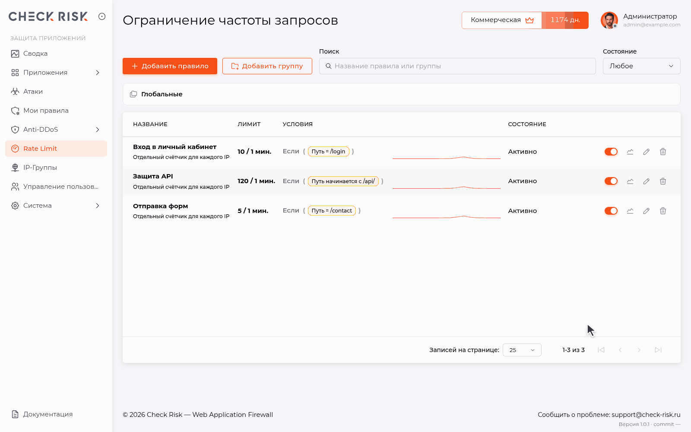](assets/rate-limit.gif)

### Anti-DDoS: атаки, источники и причины блокировки

Система позволяет анализировать DOS/DDOS атаки на L4, L7 и агрегировать их в связанные события, которые собираются в эпизоды. Для получения данных о эпизодах атак откройте подробности на странице аналитики, чтобы увидеть длительность, число заблокированных соединений и атакующие IP с географией. Это помогает быстро оценить масштаб нагрузки и понять, какой механизм защиты сработал.

| Механизм | Назначение |
| --- | --- |
| **Автоблокировка** | Реакция на аномальную активность источника |
| **СПА-IP** | Фильтрация адресов из базы опасных источников |
| **IP-группы** | Собственные списки и политики доступа |
| **Статистика эпизода** | Соединения, IP, страны и время атаки |

[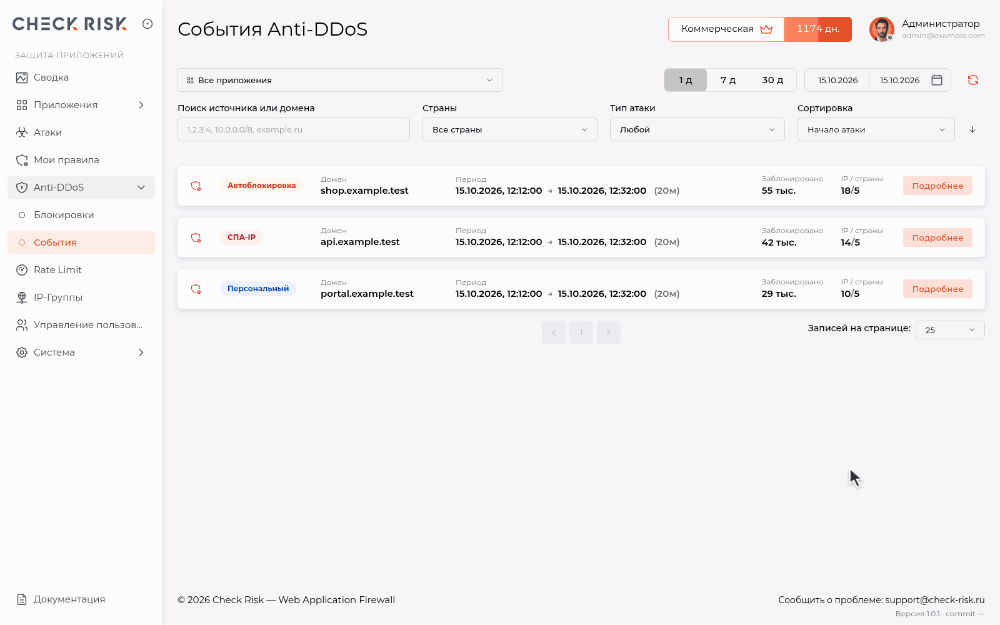](assets/antiddos-attacks.gif)

<a id="antibot"></a>

### Anti-Bot: проверка, понятная посетителю

В системе доступен продвинутый модуль Anti-Bot/ Для настройки модуля вы можете выбирать как проверку для всего приложения, так и проверку отдельных запросов. Для подтверждённых поисковых роботов можно задать отдельную политику.

**Настройка Anti-Bot:** включите защиту, выберите режим работы. Настройте правила прохождения ботов для вашего приложения. Например для скачивания файла `/downloads/catalog.pdf` задайте условие «Пропускать при совпадении». Сохраните настройки и откройте их повторно, чтобы проверить результат.

[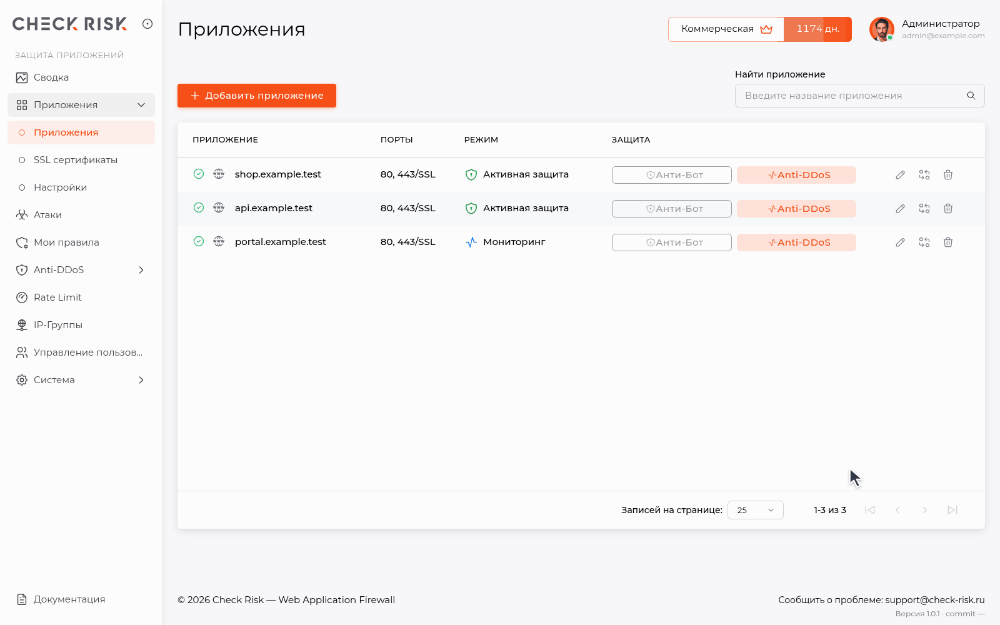](assets/antibot-settings.gif)

**Четыре режима проверки посетителя:**

<table>
  <tr>
    <td width="50%">
      <strong>Автоматическая проверка</strong><br><br>
      Проверка проходит без действий пользователя. Страница проверки запускает JavaScript, выполняет лёгкую браузерную проверку и получает проверочный cookie. Подходит для минимального влияния на обычных посетителей.
    </td>
    <td align="center" width="50%">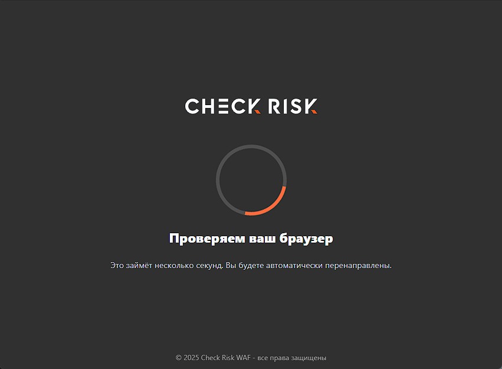</td>
  </tr>
  <tr>
    <td width="50%">
      <strong>Проверка действием (упрощённая)</strong><br><br>
      Пользователь видит кнопку «Я не робот». После нажатия запускается такая же проверка браузера, как в автоматическом режиме, и при успехе выдаётся проверочный cookie. Подходит, когда нужно явное действие пользователя.
    </td>
    <td align="center" width="50%">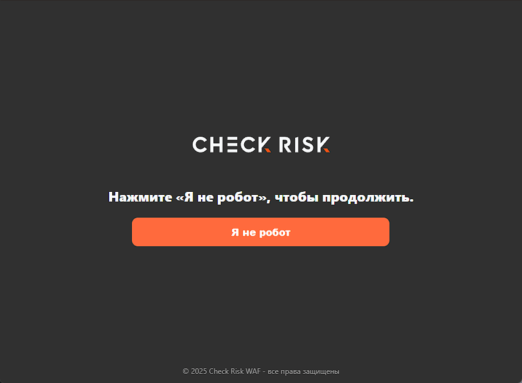</td>
  </tr>
  <tr>
    <td width="50%">
      <strong>Проверка действием (капча)</strong><br><br>
      Пользователь проходит слайдер-пазл. Система выдаёт задание, пользователь двигает ползунок, а сервер проверяет правильность позиции. При успешном решении выдаётся проверочный cookie. Это самый строгий ручной режим проверки.
    </td>
    <td align="center" width="50%">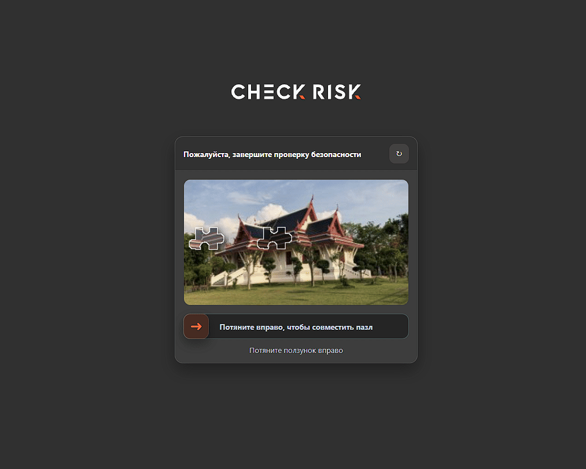</td>
  </tr>
  <tr>
    <td width="50%">
      <strong>Интеллектуальная проверка</strong><br><br>
      Система сама выбирает уровень проверки по поведению посетителя: для доверенных пользователей показывает минимальную проверку, для сомнительных кнопку или пазл. Подходит как режим по умолчанию, когда нужен баланс между удобством и защитой.
    </td>
    <td align="center" width="50%"></td>
  </tr>
</table>

### Сводка: общая картина трафика и защиты

В системе представлена сводка по всей сетевой активности: запросы, блокировки, HTTP-статусы, география, популярные страницы и источники переходов — на одном экране.

[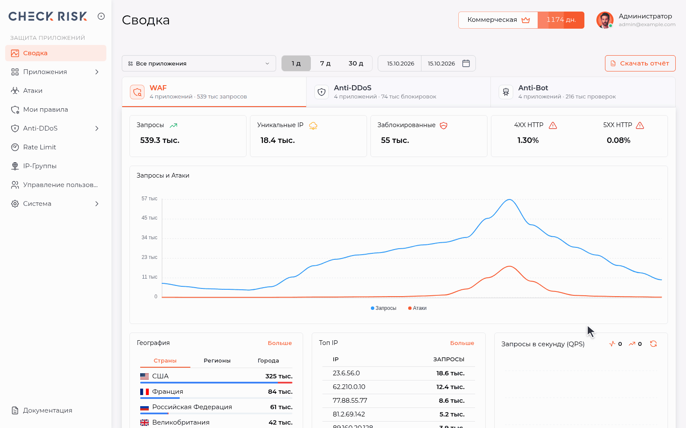](assets/dashboard.gif)

### Управление пользователями

Добавляйте сотрудников и назначайте доступ к нужным разделам и приложениям. Настройки, статистика и просмотр атак имеют отдельные права.

[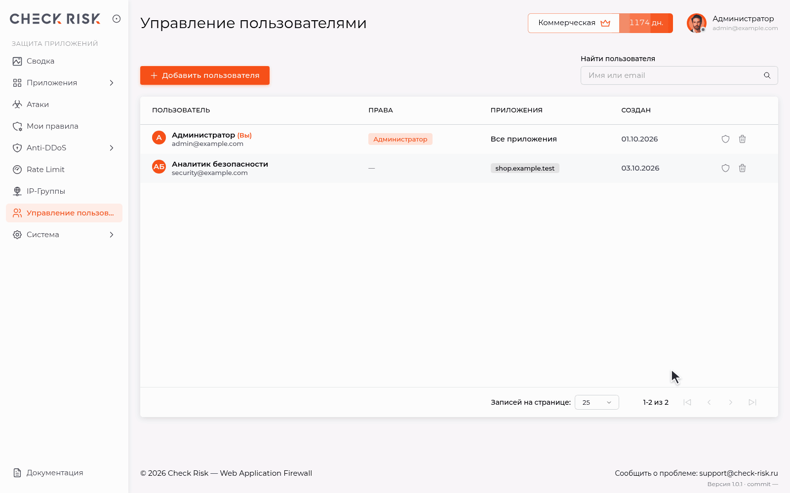](assets/users.gif)

### Обновление on-premise из панели

Получите уведомление о новой версии, откройте обновления и запустите установку. Загрузка, проверка пакета, установка компонентов и проверка сервисов отображаются в интерфейсе. Обновления также можно назначить по расписанию.

[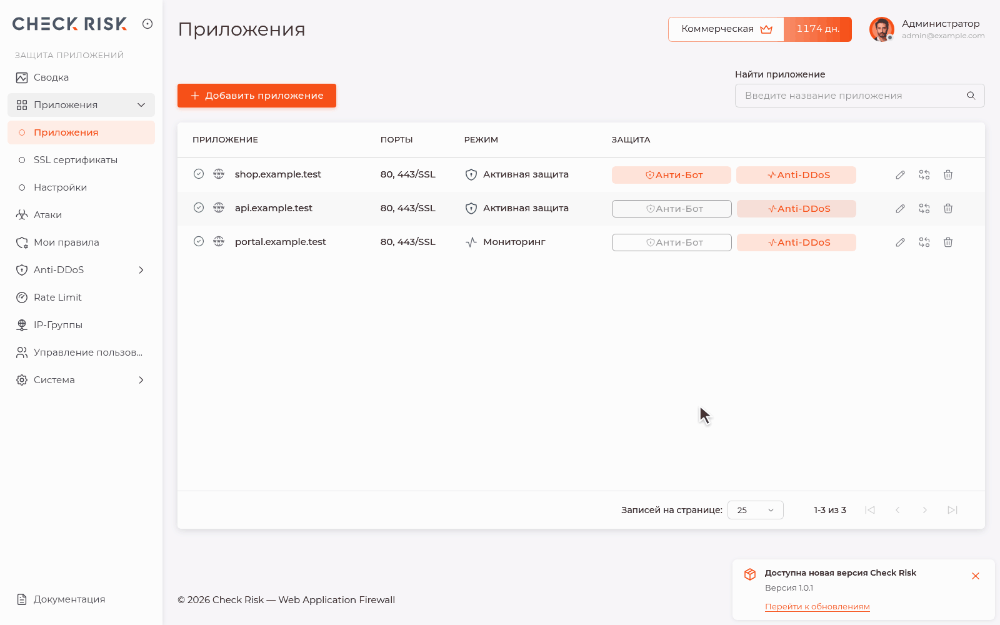](assets/updates.gif)

### Быстрое добавление приложения

Укажите домен и адрес сервера приложения. Если в upstream указан неверный порт, проверка доступности покажет ошибку и предложит изменить адрес. Исправьте порт, повторите проверку и завершите подключение. Для HTTPS можно загрузить свой сертификат или выпустить Let's Encrypt с автоматическим продлением.

[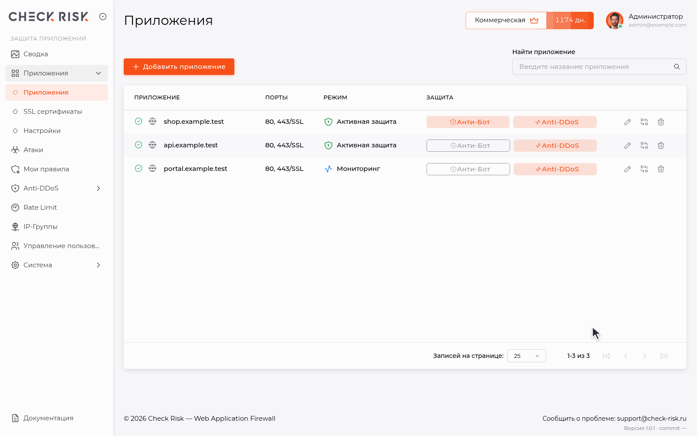](assets/applications.gif)

### Глобальные и локальные политики безопасности

В системе можно задать как общую политику для всех приложений, так и локальную для каждого веб приложения отдельно. Наследование политик позволяет централизованно управлять общей конфигурацией и учитывать особенности каждого приложения.

[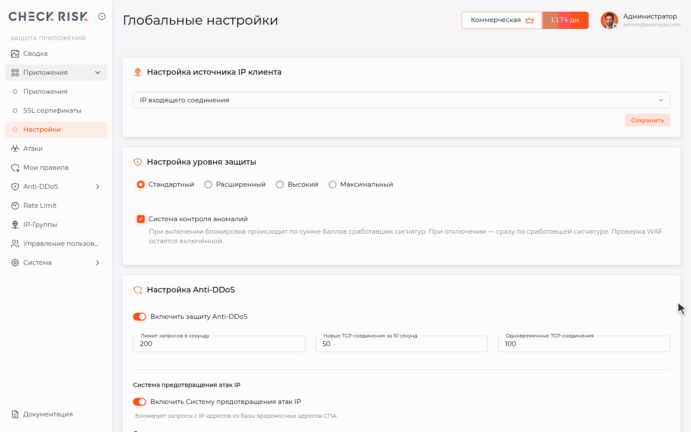](assets/settings.gif)

### Собственные страницы ошибок

В системе доступен редактор системных страниц. Вы можете менять HTML разметку и текст ответов в редакторе с предпросмотром.

[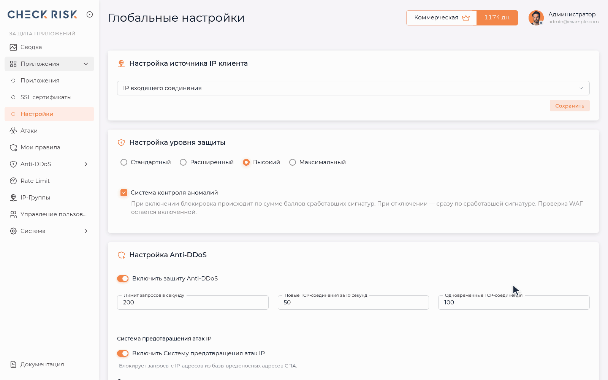](assets/custom-errors.gif)

Стандартная страница блокировки содержит идентификаторы запроса и сервера — поддержка сможет найти событие в журнале.

[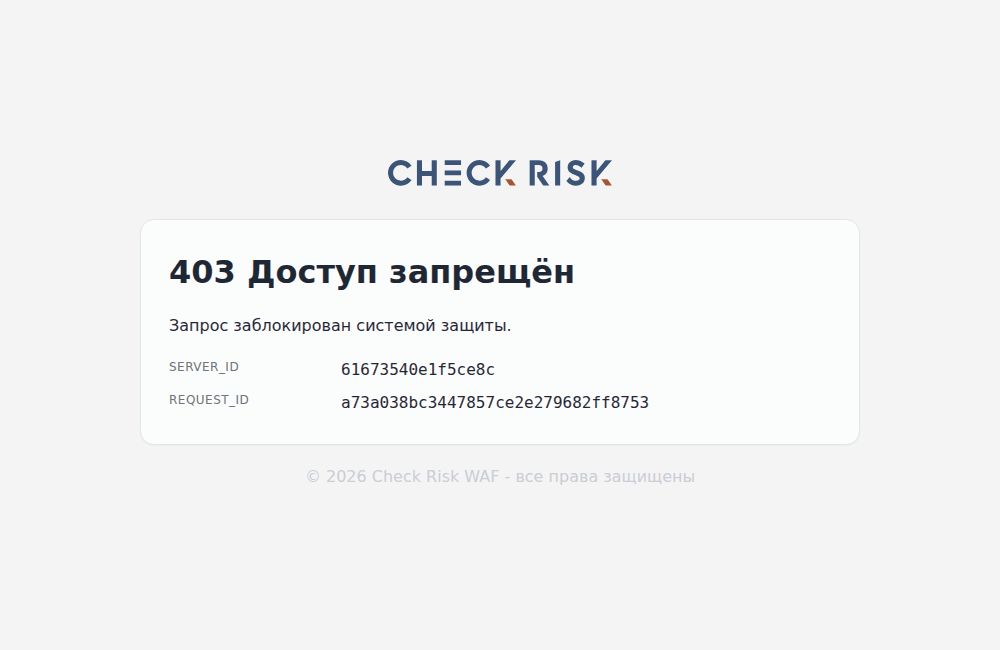](assets/blocked-403.gif)

### Сеть устройства on-premise

Управляйте интерфейсами, адресами, шлюзом, DNS и адресом панели из браузера. При изменении сети система проверяет доступность и возвращает прежнюю конфигурацию, если подключение не подтверждено.

[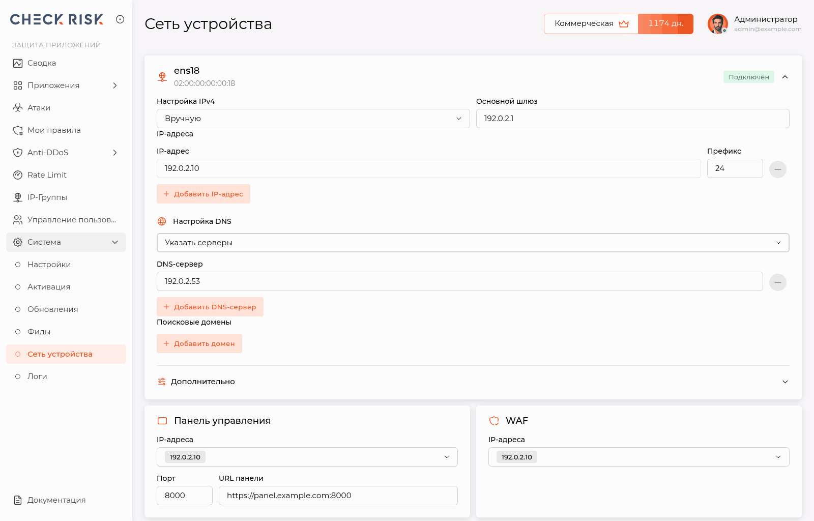](assets/network.gif)

<a id="on-premise"></a>

## Быстрая установка on-premise

Разверните Check Risk WAF на своём сервере или виртуальной машине с **Ubuntu Server 24.04 LTS, x86_64**. Фильтрация, панель и журналы будут работать в вашей инфраструктуре. Готовый архив содержит необходимые образы сервисов.

Выполните на подготовленном сервере:

```bash
(
  install_dir=$(mktemp -d "$HOME/check-risk-install.XXXXXX") &&
  cd "$install_dir" &&
  curl -fLO --retry 3 https://check-risk.ru/cr-waf_install.tar.gz &&
  curl -fLO --retry 3 https://check-risk.ru/cr-waf_install.tar.gz.sha256 &&
  sha256sum --check --strict cr-waf_install.tar.gz.sha256 &&
  tar -xzf cr-waf_install.tar.gz &&
  cd cr-waf_install &&
  sudo ./installer --lang=ru
)
```

Откройте HTTPS-ссылку из консоли и пройдите мастер: язык, сеть, параметры панели и установка. На последней странице появятся адрес панели, логин и пароль администратора.

[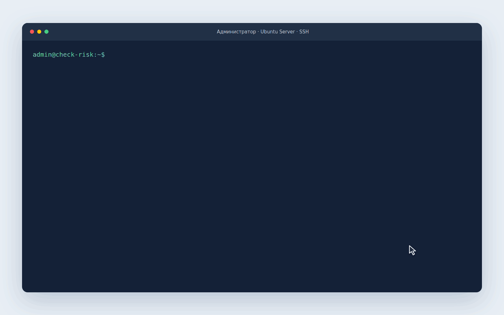](assets/installer.gif)

**[Подробная документация по установке →](https://check-risk.ru/docs/installation-check-risk-waf-all-in-one)**

<a id="saas"></a>

## SaaS: защита в облаке Check Risk

Подключите сайт без установки и обслуживания WAF-серверов. Добавьте приложение в личном кабинете, укажите сервер назначения и направьте трафик через Check Risk. Облачную инфраструктуру и обновления обслуживает наша команда; правила, события и настройки доступны вам в веб-панели.

| Вариант подключения | Как работает |
| --- | --- |
| **Облачное управление DNS** | Делегируйте зону на `ns1.check-risk.ru`, `ns2.check-risk.ru`, `ns3.check-risk.ru`. Сервис управляет записями, направляющими трафик через WAF |
| **Выделенная инфраструктура** | От трёх виртуальных машин в трёх ЦОД и статические IPv4-адреса. DNS-записи остаются под вашим управлением |

Облачное решение предусматривает размещение в **трёх ЦОД** и **SLA 99,95%**. В личном кабинете доступны DNS-зоны, записи, импорт и экспорт конфигурации. Выберите SaaS для запуска без обслуживания серверов защиты или on-premise для размещения продукта в собственной инфраструктуре.

**[Подключить SaaS →](https://check-risk.ru/)**

**[Сайт Check Risk](https://check-risk.ru/)** · [Документация](https://check-risk.ru/docs) · [Презентация](https://check-risk.ru/check-risk.ru_presentation.pdf) · [Брошюра](https://check-risk.ru/check-risk.ru_brochure.pdf)

<hr>

<a id="english"></a>

<div align="center">
  <a href="https://check-risk.ru/">
    
  </a>

  <h1>Check Risk WAF</h1>

  <p><strong>An integrated Russian solution for web application and infrastructure protection</strong></p>
  <p>WAF, Anti-Bot, Anti-DDoS, and an AI assistant. In the Check Risk cloud or on your own server.</p>

  <p>
    <a href="#saas-en"></a>
    <a href="#on-premise-en"></a>
    <a href="#protection-en"></a>
    <a href="#ai-en"></a>
  </p>

  <p>
    <a href="https://check-risk.ru/"></a><br>
    <strong>Listed in the Russian Software Registry maintained by Russia's Ministry of Digital Development.</strong><br>
    <a href="https://reestr.digital.gov.ru/reestr/7075261/">Registry entry No. 32239 dated February 17, 2026</a>
  </p>

  <p>
    <a href="https://check-risk.ru/"><strong>Website</strong></a> ·
    <a href="https://check-risk.ru/docs"><strong>Documentation</strong></a> ·
    <a href="#protection-en">Protection</a> ·
    <a href="#features-en">Features</a> ·
    <a href="#interface-en">Interface</a> ·
    <a href="#on-premise-en">Installation</a> ·
    <a href="#saas-en">SaaS</a>
  </p>

  <p><a href="#russian">Русский</a> · <a href="#english"><strong>English</strong></a></p>
</div>

<a id="protection-en"></a>

## Three core protection modules

**Check Risk WAF** protects websites, web applications, and APIs. It inspects incoming HTTP/HTTPS traffic as a reverse proxy and forwards filtered requests to protected applications. Connecting the product requires no changes to your website's code.

| Module | Protection |
| --- | --- |
| **WAF** | OWASP Top 10, SQL injection, XSS, command execution, file inclusion, path traversal, protocol anomalies, and other attacks on web applications |
| **Anti-Bot** | Automated requests, scanning, scraping, and spam. Browser checks, a button challenge, a puzzle CAPTCHA, and intelligent challenge selection |
| **Anti-DDoS** | Abnormal traffic loads, mass connections, and malicious sources. Automatic blocking, IP groups, and attack episode analysis |

Application protection is complemented by the built-in **Rate Limit** module, regularly updated feeds of malicious IP addresses and User-Agents, search engine bot verification, and custom security rules. Filtering conditions can be set by application, URL, method, headers, request body, client IP, and geographic location. This approach provides comprehensive web application security.

Check Risk lets you select a protection level for all applications or for an individual website. Monitoring mode allows you to review WAF detections before enabling blocking. In SaaS deployments, network filtering runs directly in the Check Risk infrastructure. With an on-premise installation, web applications are protected locally, including within isolated security environments.

<a id="features-en"></a>

## Check Risk WAF features

**✓** — feature available · **✗** — feature unavailable in this deployment option.

| Feature | Description | On-premise | SaaS |
| --- | --- | :---: | :---: |
| **Connecting web applications to WAF protection** | Create and manage protected domains and applications, including ports, upstream servers, SSL certificates, and individual protection settings. | **✓** | **✓** |
| **Domain ownership verification** | Verify domain ownership before connecting to cloud protection. | **✗** | **✓** |
| **Protection levels** | Configure filtering intensity from standard to maximum, globally or for a specific application. | **✓** | **✓** |
| **Traffic proxying and routing** | Receive HTTP/HTTPS traffic, inspect requests, and forward clean traffic to application servers. | **✓** | **✓** |
| **Protection against common web attacks** | Detect and block XSS, SQL injection, file inclusion attacks, remote code execution, scanners, and protocol anomalies. | **✓** | **✓** |
| **Custom WAF rules** | Create allow, block, and exception rules with conditions based on IP, geography, application, URL, host, headers, parameters, request body, and HTTP method. | **✓** | **✓** |
| **Exceptions and detection tuning** | Configure exceptions for individual rules and scenarios to reduce false positives without disabling protection entirely. | **✓** | **✓** |
| **IP groups and address lists** | Create groups of IP addresses and networks for use in allow, block, and exception rules. | **✓** | **✓** |
| **Geographic filtering** | Use the client's country in protection rules and traffic analytics. | **✓** | **✓** |
| **Anti-Bot protection** | Check suspicious automated traffic and distinguish bots from legitimate users. | **✓** | **✓** |
| **Trusted bot configuration** | Control how verified bots are handled: allow all, block all, or allow only a selected list. | **✓** | **✓** |
| **Conditional Anti-Bot checks** | Enable Anti-Bot checks only under specified conditions, such as particular URLs, methods, parameters, headers, or visitor groups. | **✓** | **✓** |
| **Request rate limiting (Rate Limit)** | Define request limits by application, client IP, and request conditions. | **✓** | **✓** |
| **Client IP source configuration** | Select a trusted source for the real client IP and define the action for an untrusted proxy chain. | **✓** | **✓** |
| **TLS/SSL settings** | Manage SSL protocols, cipher suites, HTTP/1, HTTP/2, HTTPS enforcement, and HSTS. | **✓** | **✓** |
| **Custom SSL certificate uploads** | Add your own certificates and keys with validation of their format, key and certificate match, and expiration dates. | **✓** | **✓** |
| **Let's Encrypt certificate issuance** | Issue and automatically renew certificates for public domains. Wildcard certificates through managed DNS are available in SaaS. | **✓** | **✓** |
| **Managed DNS** | Create and maintain DNS zones for domains connected to WAF, with delegation and zone status checks. | **✗** | **✓** |
| **DNS record management** | Create, modify, and disable common DNS record types, including A, AAAA, CNAME, MX, NS, TXT, CAA, SRV, and others. | **✗** | **✓** |
| **DNS zone import and export** | Import zone files, compare changes, export the target zone state, and track the status of applied changes. | **✗** | **✓** |
| **Automatic WAF DNS record synchronization** | Automatically create and update service DNS records that route domain traffic through WAF. | **✗** | **✓** |
| **Public test domains** | Obtain a test address to verify traffic through WAF before switching the primary domain. | **✗** | **✓** |
| **HTTP header configuration** | Add or remove request and response headers for proxying, compatibility, and stronger security. | **✓** | **✓** |
| **Proxy header support** | Configure forwarding of the original protocol, host, and client IP chain when proxying requests. | **✓** | **✓** |
| **Response compression** | Enable response compression to improve data transfer efficiency. | **✓** | **✓** |
| **SSE support** | Support streaming events for applications that require persistent HTTP connections. | **✓** | **✓** |
| **Custom error pages** | Customize text and HTML pages for blocked requests, rate limit violations, gateway errors, timeouts, and Anti-Bot checks. | **✓** | **✓** |
| **Event logging** | Collect request and security logs with details about the domain, client, request, status, triggered rule, and system action. | **✓** | **✓** |
| **Traffic and attack analytics** | Aggregate metrics for requests, visitors, blocks, errors, countries, pages, referral sources, User-Agents, and IP addresses. | **✓** | **✓** |
| **WAF dashboard** | Display key protection metrics: requests, visitors, blocks, errors, Anti-Bot checks, load, and top IP addresses, countries, pages, and status codes. | **✓** | **✓** |
| **Attack and episode analysis** | Group related attack events with their duration, event count, unique IP count, and blocking activity. | **✓** | **✓** |
| **HTTP request details** | Open an attack event to view request details, rule messages, response status, and the system's action. | **✓** | **✓** |
| **Creating rules from attack events** | Create a new rule or exception based on a specific event in the attack log. | **✓** | **✓** |
| **AI attack analysis** | Analyze a selected attack event, identify its nature, and prepare a recommendation or a rule for a false positive. | **✓** | **✓** |
| **SIEM integration** | Forward request and security events to external monitoring and event correlation systems. | **✓** | **✓** |
| **Global and local settings** | Configure protection settings globally for a user or individually for an application. | **✓** | **✓** |
| **Sub-user permissions** | Control access to websites, statistics, attacks, rules, IP groups, and settings; DNS access is available in SaaS. | **✓** | **✓** |
| **Plan limits and additional QPS** | Account for the subscription plan, base throughput limit, and additional paid QPS. | **✗** | **✓** |
| **Customer WAF clusters** | Dedicated cloud clusters for customers with separate operational and data storage settings. | **✗** | **✓** |

<a id="interface-en"></a>

## Control panel: key features

### Attacks: detailed analytics

The system provides detailed incident analytics. Open an incident, view its details, and hover over an underlined fragment to see the rule that was triggered. A single log shows the application, IP address, geographic location, original request, and protection action. Filters help you quickly find the event you need, while the cURL view lets you reproduce the request.

[](assets/attacks.gif)

<a id="ai-en"></a>

### AI assistant: help with incident analysis

The system includes an AI assistant for threat analysis. Open the incident details and click **"Ask AI"**. The assistant will analyze the request and explain why the rule was triggered. In the example, a SQL fragment appears in an answer to a training exercise, and the AI suggests a targeted exception.

[](assets/ai-analysis.gif)

<a id="rules-en"></a>

### Rules: configure blocking and exceptions

The system provides flexible tools for creating blocking rules and exceptions. Create a group, select an application, and add rules within it. Group conditions apply to all nested rules, so there is no need to select the website again. The visual editor supports AND/OR logic, JSONPath, XPath, headers, cookies, and request parameters.

[](assets/rule-groups.gif)

### Rate Limit: control request frequency

The Rate Limit module lets you create rules that limit the number of requests within a time window. Create a rule, set its conditions, and define request limits for login, search, or API endpoints. Then open the statistics: charts show checks and blocks, while geographic data shows the distribution by country, region, and city.

[](assets/rate-limit.gif)

### Anti-DDoS: attacks, sources, and reasons for blocking

The system analyzes DoS/DDoS attacks at L4 and L7 and groups related events into episodes. Open the details on the analytics page to see the duration, number of blocked connections, and attacking IP addresses with their geographic locations. This helps you quickly assess the scale of the load and understand which protection mechanism was triggered.

| Mechanism | Purpose |
| --- | --- |
| **Automatic blocking** | Respond to abnormal activity from a source |
| **SPA-IP** | Filter addresses using a database of malicious sources |
| **IP groups** | Custom lists and access policies |
| **Episode statistics** | Connections, IP addresses, countries, and attack timing |

[](assets/antiddos-attacks.gif)

<a id="antibot-en"></a>

### Anti-Bot: visitor-friendly checks

The system includes an advanced Anti-Bot module. You can configure checks for the entire application or for individual requests. Verified search engine bots can have a separate policy.

**Configuring Anti-Bot:** enable protection and select an operating mode. Configure bot access rules for your application. For example, to allow downloads of `/downloads/catalog.pdf`, set the condition to "Skip on match". Save the settings and reopen them to verify the result.

[](assets/antibot-settings.gif)

**Four visitor verification modes:**

<table>
  <tr>
    <td width="50%">
      <strong>Automatic verification</strong><br><br>
      Verification requires no user action. The challenge page runs JavaScript, performs a lightweight browser check, and obtains a verification cookie. This mode minimizes the impact on regular visitors.
    </td>
    <td align="center" width="50%"></td>
  </tr>
  <tr>
    <td width="50%">
      <strong>Action-based verification (simplified)</strong><br><br>
      The user sees an "I'm not a robot" button. Clicking it starts the same browser check as automatic mode, and a verification cookie is issued on success. This mode is suitable when an explicit user action is required.
    </td>
    <td align="center" width="50%"></td>
  </tr>
  <tr>
    <td width="50%">
      <strong>Action-based verification (CAPTCHA)</strong><br><br>
      The user solves a slider puzzle. The system presents a challenge, the user moves the slider, and the server checks whether the position is correct. A verification cookie is issued when the puzzle is solved successfully. This is the strictest manual verification mode.
    </td>
    <td align="center" width="50%"></td>
  </tr>
  <tr>
    <td width="50%">
      <strong>Intelligent verification</strong><br><br>
      The system selects the verification level based on visitor behavior: trusted users receive a minimal check, while suspicious visitors receive a button or puzzle challenge. This is a suitable default mode when balancing convenience and protection.
    </td>
    <td align="center" width="50%"></td>
  </tr>
</table>

### Dashboard: an overview of traffic and protection

The system brings all network activity together on one screen: requests, blocks, HTTP status codes, geographic data, popular pages, and referral sources.

[](assets/dashboard.gif)

### User management

Add team members and grant access to the required sections and applications. Settings, statistics, and attack viewing have separate permissions.

[](assets/users.gif)

### Updating an on-premise installation from the panel

Receive a notification about a new version, open Updates, and start the installation. The interface displays download progress, package verification, component installation, and service checks. Updates can also be scheduled.

[](assets/updates.gif)

### Quickly adding an application

Enter the domain and application server address. If the upstream port is incorrect, the availability check will report an error and offer to change the address. Correct the port, run the check again, and complete the setup. For HTTPS, you can upload your own certificate or issue a Let's Encrypt certificate with automatic renewal.

[](assets/applications.gif)

### Global and local security policies

The system lets you define a common policy for all applications and a local policy for each individual web application. Policy inheritance allows you to manage the shared configuration centrally while accounting for each application's requirements.

[](assets/settings.gif)

### Custom error pages

The system includes an editor for system pages. You can change the HTML markup and response text in an editor with a preview.

[](assets/custom-errors.gif)

The default block page contains request and server IDs, allowing support to locate the event in the log.

[](assets/blocked-403.gif)

### On-premise appliance networking

Manage interfaces, addresses, the gateway, DNS, and the panel address from your browser. When network settings change, the system checks connectivity and restores the previous configuration if the connection is not confirmed.

[](assets/network.gif)

<a id="on-premise-en"></a>

## Quick on-premise installation

Deploy Check Risk WAF on your own server or virtual machine running **Ubuntu Server 24.04 LTS, x86_64**. Filtering, the control panel, and logs will run within your infrastructure. The distribution archive includes the required service images.

Run the following on the prepared server:

```bash
(
  install_dir=$(mktemp -d "$HOME/check-risk-install.XXXXXX") &&
  cd "$install_dir" &&
  curl -fLO --retry 3 https://check-risk.ru/cr-waf_install.tar.gz &&
  curl -fLO --retry 3 https://check-risk.ru/cr-waf_install.tar.gz.sha256 &&
  sha256sum --check --strict cr-waf_install.tar.gz.sha256 &&
  tar -xzf cr-waf_install.tar.gz &&
  cd cr-waf_install &&
  sudo ./installer --lang=en
)
```

Open the HTTPS link shown in the console and complete the wizard: language, network, panel settings, and installation. The final page will display the panel address, administrator username, and password.

[](assets/installer.gif)

**[Detailed installation documentation →](https://check-risk.ru/docs/installation-check-risk-waf-all-in-one)**

<a id="saas-en"></a>

## SaaS: protection in the Check Risk cloud

Connect your website without installing or maintaining WAF servers. Add an application in your account, specify the upstream server, and route traffic through Check Risk. Our team maintains the cloud infrastructure and updates; you manage rules, events, and settings through the web panel.

| Connection option | How it works |
| --- | --- |
| **Cloud DNS management** | Delegate your zone to `ns1.check-risk.ru`, `ns2.check-risk.ru`, and `ns3.check-risk.ru`. The service manages the records that route traffic through WAF |
| **Dedicated infrastructure** | At least three virtual machines across three data centers, with static IPv4 addresses. DNS records remain under your control |

The cloud solution is deployed across **three data centers** with a **99.95% SLA**. Your account provides access to DNS zones, records, and configuration import and export. Choose SaaS to get started without maintaining protection servers, or on-premise to deploy the product within your own infrastructure.

**[Get started with SaaS →](https://check-risk.ru/)**

**[Check Risk website](https://check-risk.ru/)** · [Documentation](https://check-risk.ru/docs) · [Presentation](https://check-risk.ru/check-risk.ru_presentation.pdf) · [Brochure](https://check-risk.ru/check-risk.ru_brochure.pdf)
